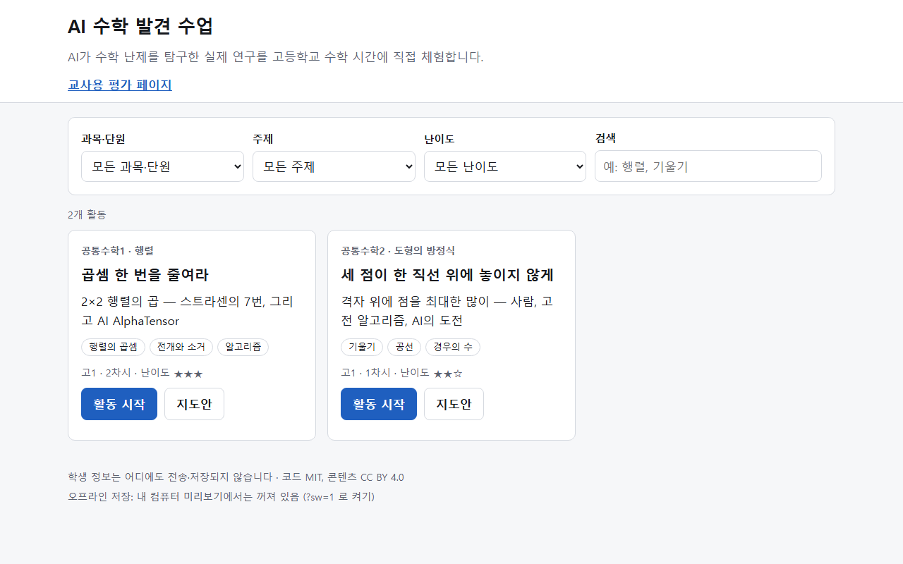
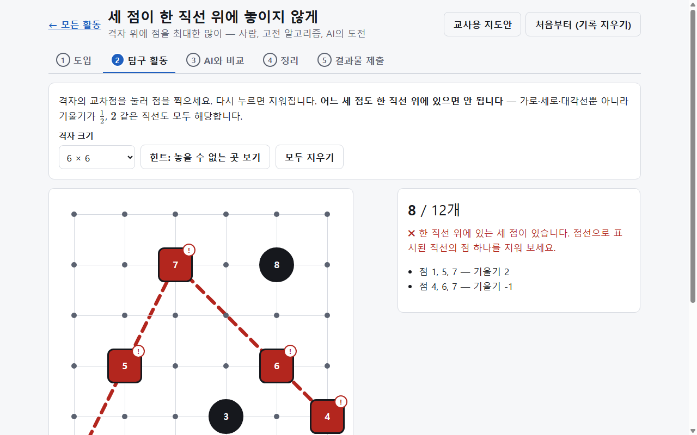
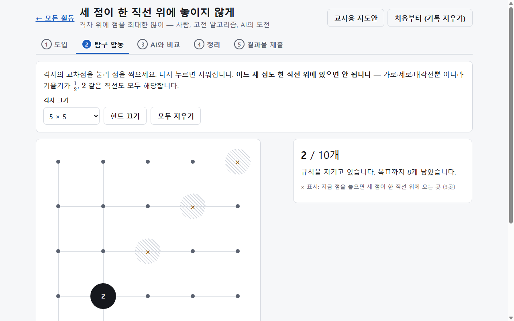
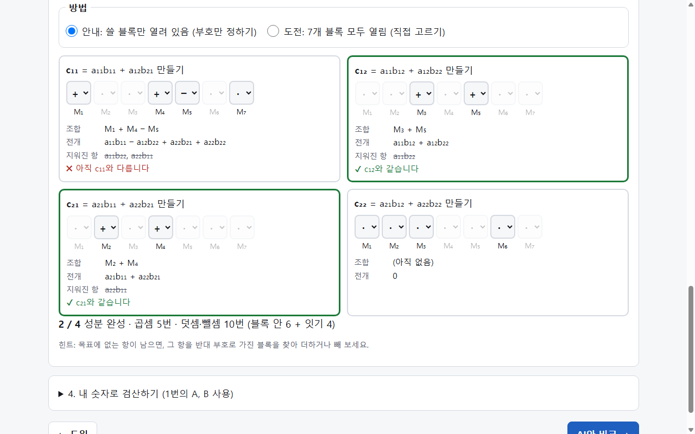
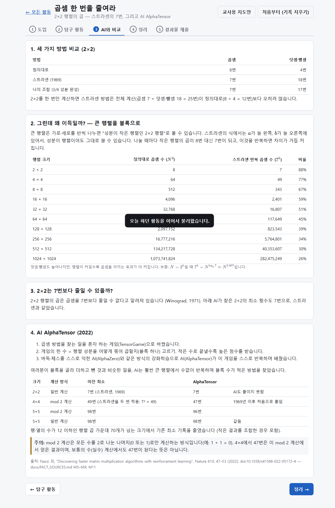
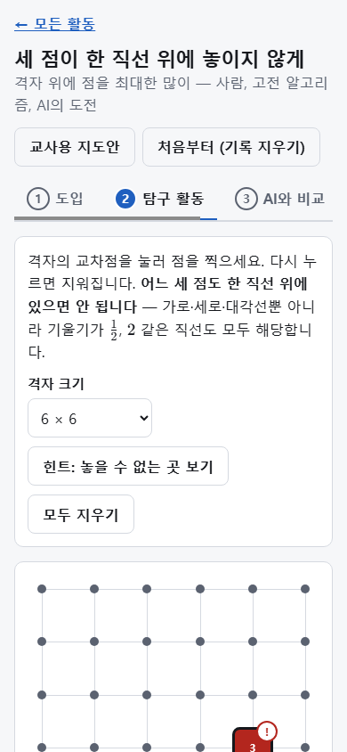
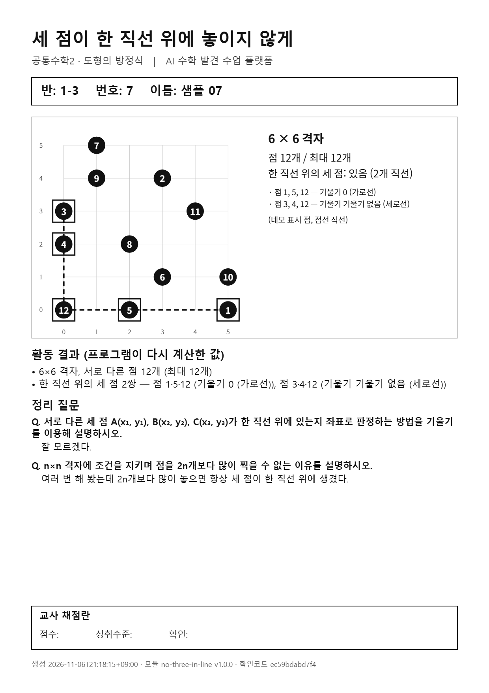
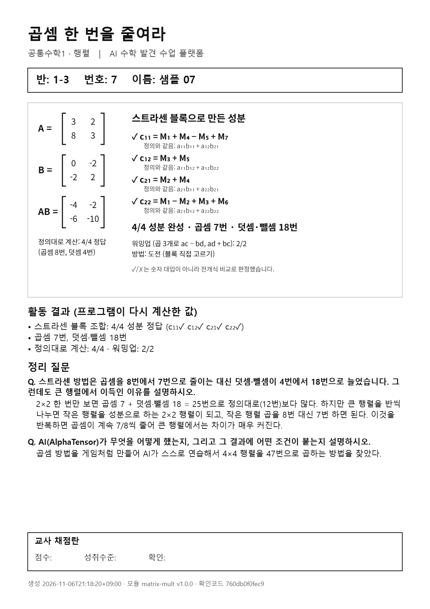
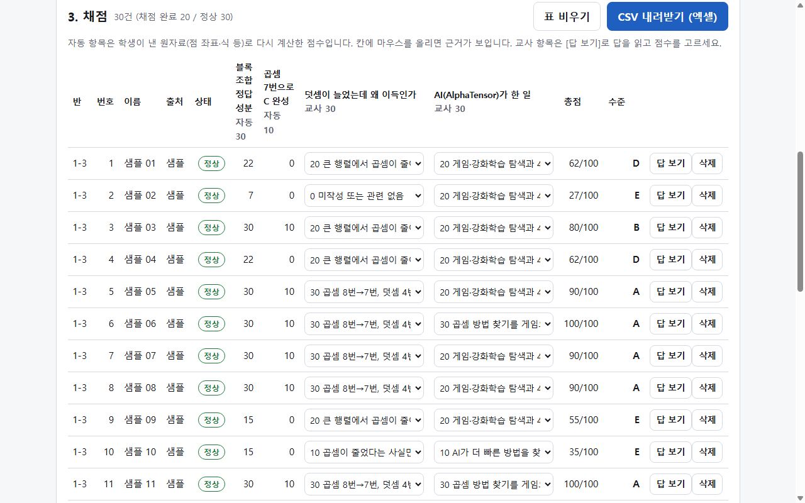
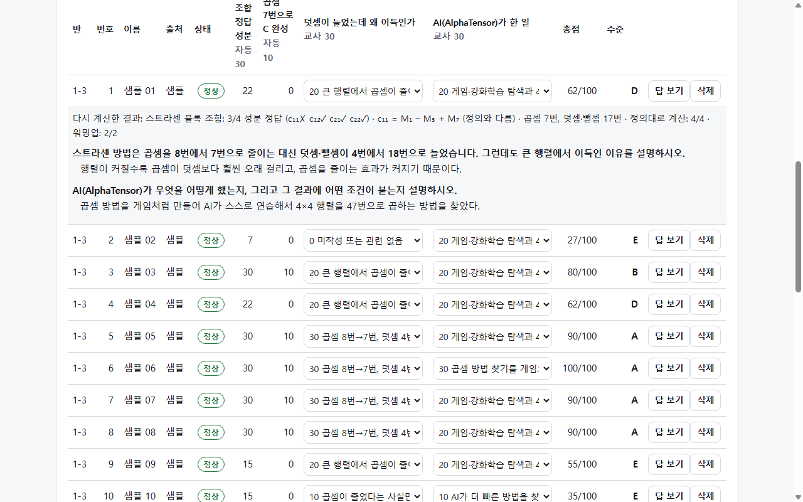

# AI 수학 발견 수업 플랫폼 — 출품 보고서 (초안)

> 이 문서는 초안입니다. 대회 공식 양식이 정해지면 그 양식으로 옮깁니다.
> 그림은 `docs/exhibition/images/`, 지도안 인쇄본은 `node tools/exhibition/capture.mjs`로 만듭니다.
> 수학·연구 관련 문장은 모두 `docs/FACT_SOURCES.md`에서 확인한 범위 안에서 썼습니다.

---

## 1. 개요

| 항목 | 내용 |
|---|---|
| 자료명 | AI 수학 발견 수업 플랫폼 |
| 대상 | 고등학교 1학년 (공통수학1·2) |
| 형태 | 웹 기반 체험형 수업 자료 + 교사용 평가 도구 + 지도안 |
| 주소 | https://matht1.github.io/ai-math-discovery/ |
| 소스 | https://github.com/mathT1/ai-math-discovery (코드 MIT, 콘텐츠 CC BY 4.0) |
| 실행 환경 | 설치 없이 웹 브라우저에서 실행 (기기별 점검 결과는 8절). 한 번 접속하면 인터넷 없이도 동작 |

AI가 수학 문제를 탐구한 실제 연구를 고등학교 수학 시간에 체험하게 하는 활동 모음입니다. 학생은 연구 문제를 교과 개념으로 직접 풀어 보고, 같은 문제를 AI와 고전 알고리즘이 어떻게 다루었는지 비교합니다. 결과물은 파일로 내고, 교사는 평가 페이지에서 한꺼번에 채점합니다.

## 2. 개발 배경과 필요성

1. **"AI가 수학을 한다"는 소식과 교실 사이의 거리.** 최근 AI가 수학 문제 탐구에 쓰인 연구가 잇따르지만, 학생에게는 "AI가 다 풀어 준다"는 막연한 인상만 남기 쉽습니다. 연구에서 AI가 실제로 무엇을 했고 무엇을 못 했는지, 교과 개념으로 확인할 수 있는 자료가 필요합니다.
2. **연구 내용의 정확한 전달.** AI 관련 보도는 과장되기 쉽습니다. 이 자료는 화면의 모든 사실을 출처와 대조하고, 출처 없는 문장과 과장 문장을 쓰지 않는 규칙을 자동 검사로 지킵니다(6절).
3. **평가 부담.** 체험 활동은 결과를 모으고 채점하는 일이 교사에게 부담입니다. 자동으로 다시 계산할 수 있는 부분은 프로그램이, 서술 평가는 교사가 맡도록 나눴습니다.
4. **학교 환경.** 설치·회원 가입이 필요 없고, 학생 정보를 어디에도 보내지 않으며, 인터넷이 불안정해도 동작해야 합니다.

## 3. 교육과정 연계

성취기준은 「2022 개정 교육과정에 따른 고등학교 수학과 공통과목 성취수준」에서 직접 확인했습니다.

| 활동 | 과목·단원 | 성취기준 | 활동에서의 연결 |
|---|---|---|---|
| 세 점이 한 직선 위에 놓이지 않게 | 공통수학2 도형의 방정식 | [10공수2-01-02] 두 직선의 평행 조건과 수직 조건을 탐구하고 이해한다. (PDF 119·136쪽) | 세 점 A, B, C가 한 직선 위 ⇔ 직선 AB와 AC의 기울기가 같음 |
| | 공통수학1 경우의 수 | [10공수1-03-01] 합의 법칙과 곱의 법칙을 이해하고, 적절한 전략을 사용하여 경우의 수와 관련된 문제를 해결할 수 있다. (PDF 38쪽) | 점을 고르는 방법의 수, 확인할 세 점 조합의 수 |
| 곱셈 한 번을 줄여라 | 공통수학1 행렬 | [10공수1-04-02] 행렬의 연산을 수행하고, 관련된 문제를 해결할 수 있다. (PDF 15·16·39쪽) | 2×2 행렬의 곱, 블록 조합의 전개로 곱이 같음을 확인 |

성취기준 해설(PDF 16쪽)의 "행과 열의 수가 각각 2를 넘지 않는 범위에서 행렬의 곱셈"에 맞춰, 계산 활동은 2×2로 한정하고 4×4·5×5 결과는 이야기로만 소개합니다. 성취수준은 성취기준별 A~E 5수준(PDF 100·136쪽)을 따릅니다.

## 4. 활동 설계

모든 활동은 같은 다섯 단계로 진행합니다: **① 도입 → ② 탐구 활동 → ③ AI와 비교 → ④ 정리(서술형 2문항) → ⑤ 결과물 제출**.

### 4-1. 세 점이 한 직선 위에 놓이지 않게 (1차시)

- **연구**: Ramanathan 외(2025), *Three methods, one problem: Classical and AI approaches to no-three-in-line*, arXiv:2512.11469
- **탐구**: n×n 격자(3~8)에 점을 찍되, 어느 세 점도 한 직선 위에 있지 않게 최대한 많이 찍습니다. 세 점이 한 직선 위에 오면 화면이 그 직선과 기울기를 바로 보여 줍니다. 판정식은 나눗셈이 없는 (x₂−x₁)(y₃−y₁) = (y₂−y₁)(x₃−x₁)이라 세로선도 오차 없이 판정합니다.
- **AI와 비교**: 최대 2n개인 이유(한 가로줄에 3개면 한 직선), 경우의 수 표(6×6에서 점 12개를 고르는 방법 1,251,677,700가지), 연구 결과(고전 방법 ILP는 19×19까지 최적임을 증명, PatternBoost는 14×14까지 최적과 같은 결과, 강화학습 PPO는 10×10까지 성공하고 11×11에서 실패).
- **핵심 메시지**: "AI는 작은 격자에서 경쟁력이 있고, 정확한 답에는 고전 방법이 여전히 필요하다."

| 공선 표시 (색 + 네모 + '!' + 점선 + 목록) | 힌트 (놓을 수 없는 곳) |
|---|---|
|  |  |

### 4-2. 곱셈 한 번을 줄여라 (2차시, 1차시 압축안 포함)

- **연구**: Fawzi 외(2022), *Discovering faster matrix multiplication algorithms with reinforcement learning*, Nature 610, 47–53
- **탐구**
  1. 2×2 행렬의 곱을 정의대로 계산합니다(곱셈 8번).
  2. 워밍업: 곱 3개로 ac − bd와 ad + bc를 만듭니다(곱셈 4번 → 3번).
  3. 스트라센(1969)의 블록 7개를 더하고 빼서 네 성분을 조립합니다. 고를 때마다 전개식과 지워지는 항이 보입니다.
- **AI와 비교**
  - 2×2를 한 번만 곱하면 스트라센 방법이 오히려 계산이 많다는 점(곱셈 7 + 덧셈·뺄셈 18)
  - 큰 행렬을 블록으로 나눠 반복하면 이득이 커진다는 점(1024×1024에서 곱셈 약 26%)
  - AlphaTensor의 결과: 4×4를 mod 2 계산에서 49번 → 47번. 2×2는 AI도 7번
- **정확성 장치**: "4×4 47번은 mod 2 계산에서의 결과"라는 조건을 화면에 함께 적고, 서술형 루브릭에서도 이 조건을 평가합니다.

| 블록 조립 (전개·지워진 항) | AI와 비교 |
|---|---|
|  |  |

### 4-3. 접근성·사용 환경

- 색만으로 정보를 주지 않습니다. 공선은 모양·기호·점선·글자로도 표시하고, 완성된 성분은 테두리 굵기와 글자로도 표시합니다.
- 키보드만으로 모든 활동을 할 수 있습니다(격자는 방향키, 선택 상자, 탭 이동).
- 휴대전화 화면(360px)부터 PC까지 같은 화면이 맞춰집니다.

## 5. 평가 방법

### 5-1. 결과물과 제출

- 학생은 **PNG 보고서**(사람이 보는 것)와 **JSON 파일**(채점용 원자료)을 저장합니다. 보고서에는 교사 채점란이 있어 그대로 인쇄해도 됩니다.
- 제출 방법은 학교 사정에 맞게 4가지 중 고릅니다: **구글 클래스룸 · 패들릿(제출 코드 붙여넣기) · 메일 · 출력물**.

| 학생 보고서 예시 (샘플 학생) | |
|---|---|
|  |  |

### 5-2. 교사 평가 페이지

- 파일을 끌어다 놓거나, 패들릿 게시물을 통째로 붙여 넣거나, 출력물을 보고 직접 입력합니다. 4가지 방법이 한 표로 모입니다.
- **자동 항목(40점)**: 학생이 낸 숫자를 믿지 않고, 원자료(점 좌표, 블록 계수)로 다시 계산합니다. 예를 들어 행렬 활동은 숫자 대입이 아니라 전개식을 비교하므로, 숫자가 우연히 맞는 오답을 걸러 냅니다.
- **교사 항목(60점)**: [답 보기]로 서술형 답을 읽고, 루브릭 기준 문구를 보며 점수를 고릅니다.
- 총점에서 **성취수준 A~E**를 계산하고, **CSV**로 내려받아 엑셀에서 씁니다.
- 파일이 저장된 뒤 고쳐졌으면 "수정 감지"로 표시합니다(SHA-256 체크섬).
- 40명분을 올리는 데 0.2초 정도 걸렸습니다(자동 시험).

| 활동 | 자동 (40) | 교사 (60) |
|---|---|---|
| 세 점이 한 직선 위에… | 규칙 준수 20, 점 개수 20 (6×6 이상에서 2n개면 만점) | 공선 판정 설명 30, 2n 상한 설명 30 |
| 곱셈 한 번을 줄여라 | 정답 성분 수 30, 곱셈 7번으로 완성 10 | 덧셈이 늘었는데 왜 이득인가 30, AI가 한 일과 조건 30 |

## 6. 내용 정확성과 개인정보

**사실 검증**
- 화면에 나오는 수학적 사실과 연구 결과는 모두 「사실–출처 표」(`docs/FACT_SOURCES.md`)에 출처와 함께 적고, 확인 수준(원문 확인 / 직접 계산 / 확인 필요)을 표시했습니다.
- 확인하지 못한 내용은 "알려져 있다", "추측"으로만 씁니다. 예: "2×2는 곱셈을 7번보다 줄일 수 없다고 알려져 있다".
- 과장되기 쉬운 문장 6개는 쓰지 않습니다(예: "AlphaTensor가 2×2 기록을 깼다", "AI가 고전 알고리즘보다 더 큰 격자에서 더 좋은 해를 찾았다"). 이 규칙은 자동 검사로 배포 때마다 확인합니다.
- 공선 판정식, 비교용 배치, 스트라센 식은 프로그램으로 전수 검증했습니다.
  - 공선 판정식: 6×6 격자의 세 점 7,140조합 전부
  - 블록 조합: 3⁷ = 2,187가지 전부

**개인정보**
- 학생의 이름·반·번호는 어떤 서버로도 보내지 않습니다. 모든 처리는 학생과 교사의 브라우저 안에서 이루어집니다.
- 활동 중 임시 저장에는 이름을 넣지 않고, 그날이 지나면 자동으로 지웁니다(공용 PC 대비).
- 외부 분석·추적 스크립트를 쓰지 않습니다.

## 7. 확장 구조

- 활동 하나가 폴더 하나입니다. 새 연구로 활동을 만들 때 정해진 파일 몇 개만 채우면 홈 목록, 결과물 저장, 교사 평가에 자동으로 들어갑니다.
  - 정해진 파일: 설정, 활동 화면, 채점 계산, 루브릭, 지도안
- 실제로 두 번째 활동(행렬)은 플랫폼 본체를 한 줄도 고치지 않고 추가했습니다.
- 새 활동은 배포 전에 형식, 성취기준 출처, 수학 판정, 금지 문장을 자동 검사로 확인합니다.
- 다음 후보: 평면 색칠 문제, 연분수(미적분Ⅱ 수열의 극한 연계) 등. 같은 표준으로 추가합니다.

## 8. 현장 적용 계획

- **교사 점검(출품 전)**: 교실 PC, 크롬북, 아이패드 등에서 점검표(`docs/DEVICE_CHECK.md`)로 확인합니다. → *결과는 점검 후 기록*
- **학생 시범 수업(2027년 3월 이후)**: 1개 학급에서 1~2차시 수업 후 짧은 설문을 합니다.
  - 확인할 것: 1차시 안에 활동을 마친 비율, 어려웠던 점, 제출 방법별 문제
  - 결과를 반영해 다음 버전(v1.1.0)을 냅니다.
- **공유**: 누구나 주소로 바로 쓸 수 있고, 코드와 콘텐츠를 자유 라이선스로 공개해 다른 교사가 고쳐 쓰거나 활동을 추가할 수 있습니다.

## 9. 개발 과정 (선택: 대회 규정에 맞게 조정)

- 교사가 기획하고, 교육과정 확인, 수업 설계 결정, 최종 검증을 했습니다.
- 구현에는 AI 코딩 도구를 활용했습니다. 단계마다 다른 AI 도구로 수학·내용 교차 검토를 하고, 사실–출처 표와 자동 시험으로 확인했습니다.
- 개발 단계: 준비 → 플랫폼 본체 → 활동 1 → 활동 2 → 품질·오프라인 → 출품
  - 각 단계의 기록: `docs/DISCUSSION_LOG.md`

---

### 부록 A. 자동 시험 현황 (2026-11-06)

| 시험 | 내용 | 결과 |
|---|---|---|
| 단위 시험 54개 | 공선 판정, 계수 전개, 채점, 결과물 형식, 체크섬, 샘플, 금지 문장 | 모두 통과 |
| 브라우저 종단 시험 | 활동 → 제출 4가지 → 교사 채점 → CSV (모듈별) | 통과 |
| 오프라인 시험 | 서버를 실제로 끈 상태에서 전 과정 | 통과 |
| 일괄 채점 시험 | 40명 업로드 (미작성·수정 포함) | 0.2초, 감지 정상 |

### 부록 B. 출처

- Ramanathan, P. 외 (2025). Three methods, one problem: Classical and AI approaches to no-three-in-line. arXiv:2512.11469.
- Fawzi, A. 외 (2022). Discovering faster matrix multiplication algorithms with reinforcement learning. *Nature*, 610, 47–53. doi:10.1038/s41586-022-05172-4
- Strassen, V. (1969). Gaussian elimination is not optimal. *Numerische Mathematik*, 13, 354–356.
- Winograd, S. (1971). On multiplication of 2 × 2 matrices. *Linear Algebra and its Applications*, 4(4), 381–388.
- 「2022 개정 교육과정에 따른 고등학교 수학과 공통과목 성취수준」 (발행처·연도는 원문 표지 확인 후 기입)
