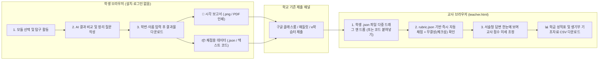

# AI 수학 발견 논문 기반 수업 플랫폼 — Antigravity 초안 계획서

> 작성자: Antigravity
> 작성일: 2026-11-05
> 기준 문서: `docs/PROJECT_BRIEF.md`

---

## 1. 요청자 결정 필요 항목 (7절 질문 및 설계 선택지)

본격적인 개발에 앞서 요청자(선생님)의 확인 및 선택이 필요한 사항입니다. 각 항목에는 Antigravity의 **권장안**을 함께 제시합니다.

| 번호 | 결정 항목 | 선택지 | Antigravity 권장안 및 이유 |
|---|---|---|---|
| **Q1** | **첫 버전(MVP) 모듈 선택 (1~2개)** | ① `matrix-mult` (AlphaTensor) + `no-three-in-line`<br>② `no-three-in-line` + `continued-fraction`<br>③ 1순위 4개 중 단일 모듈 우선 완성 | **① `matrix-mult` + `no-three-in-line` (2개)**<br>- 고1 공통과목(공통수학1·2)에 직결되어 활용도가 가장 높음.<br>- 대수 퍼즐형(`matrix-mult`)과 기하/조합 보드게임형(`no-three-in-line`) 두 가지 대표 UI 패턴을 검증할 수 있어 이후 모듈 확장의 템플릿 역할을 함. |
| **Q2** | **학생 다운로드 결과물 형식** | ① **단일 HTML/PNG 보고서 + JSON 분리** (파일 2개)<br>② **단일 PNG 이미지 내 JSON 메타데이터(Steganography/tEXt 청크) 또는 단일 ZIP**<br>③ **PDF 인쇄/저장(사람용) + `.json` 파일 다운로드(평가용)** | **③ `.json` 파일(교사 제출·재열람용) + 한눈에 보는 `.png` (또는 브라우저 인쇄 기반 PDF) 요약 카드 병행**<br>- 한국어 폰트 깨짐 없이 즉시 시각 확인이 가능한 고해상도 PNG 요약 카드(학번·이름·탐구 그래프·답안 포함)와 교사용 일괄 채점기에 넣을 `.json`을 함께 다운로드(또는 단일 버튼으로 순차 다운로드). |
| **Q3** | **평가 방식 (루브릭 구조)** | ① 100점 만점 점수형 (자동 채점 70% + 서술형 교사 채점 30%)<br>② 성취수준형 (A/B/C 또는 상/중/하) + 교사 피드백란<br>③ 점수형 + 성취수준 자동 변환 병행 | **③ 점수형(정량 자동 채점 + 서술형 가점) + 성취수준(A~C) 병행**<br>- 수행평가 및 생기부(세부능력 및 특기사항) 기초 자료로 쓰기 위해 정량 점수와 성취수준, 학생 서술형 답변 모음을 CSV로 한 번에 뽑아주는 것이 교사 업무 경감에 가장 유리함. |
| **Q4** | **학생 제출 경로** | ① 구글 클래스룸 / 패들릿 / 위두랑 등 파일 첨부<br>② QR코드/단축 텍스트 복사 제출 보조 | **① 파일 업로드 방식을 기본으로 하되, 클립보드 문자열 복사(Base64 코드) 보조 지원**<br>- 태블릿(아이패드·갤럭시탭)에서 파일 탐색기 조작을 어려워하는 학생을 위해 "제출 코드 복사" 버튼도 함께 제공하면 패들릿·구글 설문지 텍스트 칸으로도 제출 가능. |
| **Q5** | **교육자료전 출품 일정 및 요건** | - 시도대회 / 전국대회 출품 마감일<br>- 설명서(보고서) 분량 및 시연 환경(오프라인 부스 여부) | 요청자 확인 필요 (오프라인 심사장을 대비해 인터넷 연결 없이도 로컬 서버/PWA로 100% 작동하도록 설계 권장). |
| **Q6** | **저장소 공개 범위 및 라이선스** | ① 코드 MIT + 교육 콘텐츠 CC BY-NC-SA 4.0<br>② 전체 MIT 또는 CC BY 4.0 | **① 코드 MIT + 수업 자료(지도안·문항) CC BY-SA 4.0**<br>- 오픈소스 생태계 기여와 교육자료전 공개 규정을 동시에 만족. |

---

## 2. 기술 스택과 선택 이유

> **핵심 원칙**: "교사 1명이 수년간 빌드 오류나 의존성 지옥 없이 유지보수할 수 있고, 새 모듈을 폴더 하나 복사해서 추가할 수 있는가?"

### 2-1. 기술 선택 비교 및 결론: **No-Build Vanilla ES Modules (순수 HTML/CSS/JS) + GitHub Actions 정적 검증**

| 구분 | 후보 A: Vanilla JS (ES Modules, No-Build) **[채택]** | 후보 B: Vite + React/Svelte 등 SPA 프레임워크 |
|---|---|---|
| **학교 환경/호환성** | 표준 브라우저 내장 기능만 사용하여 크롬북·태블릿·구형 PC 어디서나 즉시 동작 | 동일하나 빌드 산출물 배포 단계 필요 |
| **유지보수성 (교사 1인)** | **최상**. `node_modules` 버전 충돌·보안 경고 없음. 3년 뒤에도 텍스트 에디터만으로 수정 가능 | npm 패키지 노후화로 1~2년 뒤 빌드 실패 위험 존재 |
| **모듈 확장성 (R6)** | **최상**. `modules/<id>/` 폴더와 `modules/registry.json`(또는 자동 스캔 스크립트)만 추가하면 즉시 작동 | 모듈 추가 시 재빌드·번들링 필요, 외부 기여자 진입장벽 상승 |
| **비용/배포 (R3)** | GitHub 저장소 푸시 즉시 GitHub Pages 반영 (빌드 시간 0초) | GitHub Actions 빌드 파이프라인 필요 |

### 2-2. 세부 기술 구성
- **코어 언어**: HTML5, Modern CSS (CSS Grid/Flexbox, CSS Variables 디자인 시스템), JavaScript (ES2022+ ES Modules)
- **수식 렌더링**: **KaTeX** (로컬 `vendor/` 폴더에 번들링하여 오프라인·학교 방화벽 완벽 대응)
- **시각화/인터랙션**: HTML5 `<canvas>` 및 **SVG** (격자 점 배치, 행렬 블록 퍼즐, 연분수 수렴 그래프 등 모듈 특성에 맞춰 경량 공통 유틸리티 제공)
- **결과물 생성 및 채점 처리 (클라이언트 100%)**:
  - **JSON 생성/검증**: 순수 JS 객체 직렬화 + 간단한 무결성 해시(CRC32 또는 SHA-256 앞 8자리 체크섬)
  - **시각 보고서(PNG/PDF)**: Canvas API 기반 요약 리포트 이미지(`.png`) 생성 + `@media print` 전용 스타일시트를 통한 깔끔한 PDF 인쇄/저장
  - **교사용 CSV/엑셀 내보내기**: UTF-8 BOM이 포함된 CSV 생성 (한글 엑셀에서 클릭 시 글자 깨짐 방지)
- **오프라인 지원**: Service Worker (`sw.js`)를 통한 정적 자산 및 `data/` JSON 캐싱 (한 번 접속하면 인터넷이 끊겨도 수업 가능)
- **Pyodide 배제 이유**: 초기 로딩 용량(수십 MB)이 크고 학교 와이파이 환경에서 동시 접속 시 병목을 유발함. 이 플랫폼의 모든 활동(행렬 연산, 공선 판정, 연분수 계산 등)은 순수 JavaScript로 1ms 이내에 처리 가능하며, AI 학습 결과는 `data/*.json`에 사전 계산해 두므로 무거운 런타임이 불필요함.

---

## 3. 저장소 폴더 구조

```text
idea2-math-ai-platform/
├── index.html                  # 플랫폼 홈 (단원·주제·난이도별 필터, 모듈 카드 그리드)
├── module.html                 # 모듈 공통 실행 껍데기 (상단 탭: 도입 → 탐구활동 → AI비교 → 정리/다운로드, 교사용 가이드 모달)
├── teacher.html                # 교사용 평가 센터 (학생 JSON/코드 일괄 업로드, 루브릭 자동채점, 통계 차트, CSV 다운로드)
├── assets/
│   ├── css/
│   │   ├── main.css            # 공통 디자인 시스템 (색각 이상 배려 팔레트, 반응형, 인쇄 스타일)
│   │   └── module-shell.css    # 모듈 공통 레이아웃 스타일
│   ├── js/
│   │   ├── app.js              # 홈 화면 모듈 카탈로그 로더 및 검색/필터
│   │   ├── module-loader.js    # module.html에서 URL 파라미터(?id=...)로 해당 모듈을 동적 로드하는 코어 엔진
│   │   ├── exporter.js         # 학생 결과물(JSON + PNG 요약 카드 + 텍스트 코드) 생성 및 체크섬 부여 공통 모듈
│   │   ├── grader.js           # 교사용 일괄 채점 엔진 (module별 rubric.json 기반 자동 채점 및 CSV 출력)
│   │   └── utils/              # 수학/시각화 공통 유틸 (분수 연산, 격자 캔버스 헬퍼, 접근성 패턴 렌더러)
│   └── vendor/
│       └── katex/              # 오프라인 대응용 KaTeX 로컬 파일
├── modules/
│   ├── registry.json           # 등록된 모듈 ID 목록 (새 모듈 추가 시 ID 한 줄 추가, 또는 GitHub Action으로 자동 갱신)
│   ├── _template/              # 새 모듈 제작용 표준 템플릿 폴더 (복사해서 바로 시작)
│   ├── matrix-mult/            # [모듈 1] AlphaTensor 행렬 곱셈 횟수 줄이기
│   │   ├── module.json         # 모듈 메타데이터
│   │   ├── activity.js         # 모듈 전용 활동 UI 및 로직 (표준 라이프사이클 함수 export)
│   │   ├── activity.css        # 모듈 전용 추가 스타일 (선택)
│   │   ├── schema.json         # 학생 결과물 JSON 구조 정의
│   │   ├── rubric.json         # 자동/수동 평가 루브릭 정의
│   │   ├── guide.md            # 교사용 수업 지도안 및 해설
│   │   └── data/
│   │       └── strassen_alphatensor.json  # 고전(8회), 스트라센(7회), AlphaTensor 해 데이터
│   └── no-three-in-line/       # [모듈 2] 세 점이 일직선에 놓이지 않게 (PatternBoost)
│       ├── module.json
│       ├── activity.js
│       ├── schema.json
│       ├── rubric.json
│       ├── guide.md
│       └── data/
│           └── optimal_grids.json         # n=3~12 격자별 알려진 최적해 및 AI(PatternBoost) 탐색 해
├── scripts/
│   └── validate-modules.mjs    # 모듈 표준(module.json, schema, rubric) 무결성 검사 스크립트 (CI 및 로컬 점검용)
└── docs/
    ├── PROJECT_BRIEF.md        # 기준 문서 (수정 금지)
    ├── FINAL_PLAN.md           # 합의된 최종 계획서
    ├── CONTRIBUTING_MODULE.md  # 새 모듈 추가 가이드 (교사·기여자용)
    └── EXHIBITION_KIT.md       # 교육자료전 출품 보조 자료 목록 및 설명서 초안
```

---

## 4. 모듈 표준 확정안 (`module.json`, `schema.json`, `rubric.json`, JS 인터페이스)

플랫폼 본체(`module.html`, `teacher.html`)를 전혀 수정하지 않고도 새 모듈이 목록, 활동 화면, 결과물 출력, 교사용 자동 채점에 완벽히 통합되도록 **4가지 표준 규격**을 정의합니다.

### 4-1. `module.json` (메타데이터 표준)
```json
{
  "id": "no-three-in-line",
  "version": "1.0.0",
  "title": "세 점이 한 직선 위에 놓이지 않게",
  "subtitle": "AI(PatternBoost)와 겨루는 격자 위의 기하 퍼즐",
  "subject": "공통수학2",
  "unit": "도형의 방정식",
  "topics": ["직선의 기울기", "공선 조건", "경우의 수"],
  "achievement_standards": [
    {
      "code": "10공수2-01-02",
      "description": "두 직선의 평행 조건과 수직 조건을 탐구하고 이해한다."
    },
    {
      "code": "10공수1-03-01",
      "description": "합의 법칙과 곱의 법칙을 이해하고, 적절한 전략을 사용하여 경우의 수와 관련된 문제를 해결할 수 있다."
    }
  ],
  "grade": ["고1"],
  "periods": 1,
  "difficulty": 2,
  "paper": {
    "title": "Three methods, one problem: Classical and AI approaches to no-three-in-line",
    "authors": "Charton et al.",
    "year": 2025,
    "url": "https://arxiv.org/abs/2512.11469",
    "code": "https://github.com/pranav-ramanathan/N3L_PatternBoost",
    "ai_method": "Transformer + 국소 탐색(PatternBoost)"
  },
  "story": {
    "hook": "바둑판 위에 돌을 놓을 때, 어느 세 돌도 한 직선 위에 있지 않게 하려면 최대 몇 개까지 놓을 수 있을까요?",
    "ai_connection": "100년 넘게 수학자들이 손으로 찾던 격자 배치 문제를 최신 AI(PatternBoost)가 좋은 패턴을 학습하고 다듬어 새로운 해를 찾아냈습니다."
  },
  "questions": [
    {
      "id": "q1",
      "prompt": "세 점 A(x1, y1), B(x2, y2), C(x3, y3)가 한 직선 위에 있는지(공선 조건)를 좌표와 기울기를 이용해 판별하는 방법을 설명해 보세요.",
      "type": "text"
    },
    {
      "id": "q2",
      "prompt": "내가 찾은 배치와 AI(PatternBoost)의 해를 비교했을 때, 대칭성이나 점들의 분포에서 어떤 차이점이나 규칙이 보이나요?",
      "type": "text"
    }
  ],
  "files": {
    "entry": "activity.js",
    "schema": "schema.json",
    "rubric": "rubric.json",
    "guide": "guide.md"
  }
}
```

### 4-2. 학생 결과물 표준 봉투 형식 (`StudentReport JSON`)
모든 모듈의 결과물은 공통 헤더(`meta`, `student`, `summary`, `reflections`, `checksum`)와 모듈 고유 데이터(`activity_data`)로 구성됩니다.
```json
{
  "meta": {
    "platform_version": "1.0.0",
    "module_id": "no-three-in-line",
    "module_version": "1.0.0",
    "submitted_at": "2026-11-05T14:30:00+09:00",
    "duration_sec": 1140
  },
  "student": {
    "school_id": "10512",
    "name": "홍길동",
    "class_group": "1학년 5반"
  },
  "activity_data": {
    "max_n_cleared": 6,
    "best_grid_6x6": {
      "n": 6,
      "points": [[0,1], [0,4], [1,2], [1,5], [2,0], [2,3], [3,2], [3,5], [4,0], [4,3], [5,1], [5,4]],
      "point_count": 12,
      "collinear_violations": 0,
      "attempts": 8,
      "hints_used": 1
    },
    "ai_comparison_viewed": true
  },
  "reflections": {
    "q1": "두 점 A, B의 기울기와 B, C의 기울기가 같으면 세 점은 한 직선 위에 있습니다. 분모가 0일 수 있으므로 (y2-y1)(x3-x2) = (y3-y2)(x2-x1)로 판정합니다.",
    "q2": "AI가 찾은 해는 격자 중심을 기준으로 대칭적인 패턴을 이루고 있어 중앙이 비어 있고 가장자리에 점들이 고르게 분포합니다."
  },
  "checksum": "a9f4c21b"
}
```
- **체크섬(`checksum`) 정책**: `student` + `activity_data` + `reflections` 직렬화 문자열에 플랫폼 솔트(salt)를 더한 경량 해시(CRC32/FNV-1a). 학생이 메모장으로 점수를 단순 수정하면 교사용 평가 페이지에서 `"⚠️ 파일 수정 감지됨"` 배지를 띄워주되, 데이터 열람은 가능하게 처리(학교 현장의 유연성 확보).

### 4-3. `rubric.json` (교사용 자동 채점 및 루브릭 표준)
플랫폼의 `grader.js`가 코드를 고치지 않고도 JSON 경로(`field`)와 연산자(`op`)만으로 모든 모듈을 자동 채점할 수 있도록 선언적 규칙으로 정의합니다.
```json
{
  "module_id": "no-three-in-line",
  "total_points": 100,
  "grade_cutoffs": { "A": 85, "B": 65, "C": 0 },
  "criteria": [
    {
      "id": "c1_rule_valid",
      "title": "공선 조건 준수 (세 점 일직선 없음)",
      "type": "auto",
      "points": 30,
      "rules": [
        { "field": "activity_data.best_grid_6x6.collinear_violations", "op": "==", "value": 0, "score": 30 }
      ]
    },
    {
      "id": "c2_optimality",
      "title": "6×6 격자 최대 점 배치 달성도 (목표 12개)",
      "type": "auto",
      "points": 40,
      "rules": [
        { "field": "activity_data.best_grid_6x6.point_count", "op": ">=", "value": 12, "score": 40 },
        { "field": "activity_data.best_grid_6x6.point_count", "op": ">=", "value": 10, "score": 30 },
        { "field": "activity_data.best_grid_6x6.point_count", "op": ">=", "value": 8, "score": 20 }
      ]
    },
    {
      "id": "c3_reflection",
      "title": "수학적 원리(기울기·공선) 및 AI 해 비교 서술",
      "type": "manual_with_auto_check",
      "points": 30,
      "auto_check": {
        "fields": ["reflections.q1", "reflections.q2"],
        "min_length": 20,
        "default_score_if_met": 20
      },
      "teacher_guide": "기울기 공식 또는 외적/비례식을 언급했는지(+5점), AI 해의 기하학적 특징을 구체적으로 서술했는지(+5점) 확인하여 가감합니다."
    }
  ]
}
```

### 4-4. `activity.js` (모듈 스크립트 인터페이스)
각 모듈의 `activity.js`는 단 4개의 표준 메서드만 export하면 플랫폼 껍데기(`module-loader.js`)가 탭 전환, 타이머, 결과물 저장을 모두 알아서 처리합니다.
- `init(containerEl, moduleMeta, data)`: 활동 화면 렌더링 및 초기화
- `renderAIComparison(containerEl, studentState, data)`: 학생 해와 논문 AI 해를 나란히 비교 시각화
- `getResultData()`: `activity_data`에 들어갈 현재 학생 탐구 결과 객체 반환
- `renderSummaryCanvas(canvasEl, studentState)`: PNG 보고서에 들어갈 모듈 핵심 결과 그림 그리기

---

## 5. 결과물 다운로드 형식과 평가 흐름



1. **학생 경험**:
   - 활동 중 입력한 내용은 브라우저 `localStorage`에 자동 임시 저장되어 실수로 창을 닫아도 날아가지 않음.
   - 마지막 [결과물 저장] 탭에서 학번·이름을 입력하면 **[결과물 패키지 다운로드 (.png + .json)]** 버튼과 **[제출용 코드 복사]** 버튼 제공.
   - 파일명은 교사가 알아보기 쉽게 자동 지정: `고1_10512_홍길동_no-three-in-line.json` / `.png`.
2. **교사 경험 (`teacher.html`)**:
   - 학생 파일 30개를 마우스로 한 번에 드래그 앤 드롭하면 0.1초 만에 학번순 표로 정리됨.
   - 각 학생의 자동 채점 점수, 시도 횟수, 소요 시간, 체크섬 정상 여부가 표시되며, 서술형 답변(`q1`, `q2`)을 표에서 바로 읽고 점수를 클릭해 조정 가능.
   - **[엑셀(CSV) 다운로드]** 클릭 시 학번, 이름, 총점, 성취수준(A~C), 세부 항목 점수, 서술형 원문이 담긴 CSV 파일 즉시 다운로드.

---

## 6. MVP 범위: 첫 출시 모듈(2개)과 플랫폼 코어 기능

첫 출시(MVP)에서는 **플랫폼 코어 전체(100%)**와 **교과 직결도가 가장 높은 대표 모듈 2개**를 완벽한 품질로 구현합니다.

1. **플랫폼 코어 기능**:
   - 단원별·주제별·학년별 필터링이 가능한 반응형 홈 화면 (`index.html`)
   - 4단계 수업 흐름(도입 스토리 → 탐구 활동 → AI 해 비교 → 정리 및 결과물 다운로드) 표준 쉘 (`module.html`)
   - 교사용 지도안(`guide.md`) 열람 뷰어 및 교사용 일괄 평가·집계 페이지 (`teacher.html`)
   - 모듈 표준 검증 스크립트 (`scripts/validate-modules.mjs`)
2. **MVP 출시 모듈 2개**:
   - **모듈 1 (`no-three-in-line`)**: 공통수학2 <도형의 방정식> & 공통수학1 <경우의 수> 연계. 시각적 직관성이 뛰어나고 교육자료전 시연 시 심사위원이 10초 만에 규칙을 이해하고 빠져들 수 있는 킬러 콘텐츠.
   - **모듈 2 (`matrix-mult`)**: 2022 개정 교육과정 공통수학1에 부활한 <행렬> 단원의 최고 심화·융합 콘텐츠(AlphaTensor). 2×2 행렬 곱셈을 8번에서 7번(스트라센)으로 줄이는 대수적 재구성을 블록 조립 퍼즐로 체험.

*(※ 요청자가 단일 모듈 우선 완성을 원할 경우 `no-three-in-line`을 1차로, `matrix-mult`와 `continued-fraction`을 2차로 순차 구현)*

---

## 7. 모듈별 상세 설계

### 7-1. 모듈 1: `no-three-in-line` (세 점이 한 직선 위에 놓이지 않게)

- **참고 논문**: *Three methods, one problem: Classical and AI approaches to no-three-in-line* (arXiv:2512.11469) — PatternBoost (트랜스포머와 국소 탐색을 결합해 큰 격자에서 새로운 구성을 탐색)
- **학습 목표**:
  1. 좌표평면 위의 세 점이 한 직선 위에 있을 조건(기울기 일치)을 대수적으로 설명할 수 있다.
  2. $n \times n$ 격자에서 공선 조건을 피하며 최대 개수($2n$개)의 점을 배치하는 전략을 탐구할 수 있다.
  3. 인간이 세운 대칭적 규칙과 AI(PatternBoost)가 탐색한 해의 구조를 비교할 수 있다.
- **2022 개정 교육과정 성취기준 (검증 완료)**:
  - `[10공수2-01-02]` 두 직선의 평행 조건과 수직 조건을 탐구하고 이해한다. *(직선의 기울기 개념 활용)*
  - `[10공수1-03-01]` 합의 법칙과 곱의 법칙을 이해하고, 적절한 전략을 사용하여 경우의 수와 관련된 문제를 해결할 수 있다. *(비둘기집 원리로 최대 $2n$개임을 추론)*
- **차시 활동 흐름 (1차시, 50분)**:
  1. **도입 (5분)**: "바둑판 한 줄에 최대 2개씩만 놓을 수 있다면 $n \times n$ 격자에는 최대 몇 개($2n$개)까지 놓을 수 있을까? 대각선까지 고려해도 항상 $2n$개가 가능할까?" 질문 제시.
  2. **탐구 활동 (20분)**:
     - 단계별 격자($n=3, 4, 5, 6$, 심화 $n=8$) 인터랙티브 보드 제공.
     - 격자 교차점을 클릭해 점을 놓으면, 이미 놓인 두 점과 일직선이 되는 모든 격자점과 직선(기울기 기약분수 $\frac{\Delta y}{\Delta x}$ 표시)이 실시간 하이라이트됨.
     - **접근성 반영**: 위험/금지 위치는 붉은색뿐만 아니라 **빗금 패턴과 `×` 기호**, 놓인 점은 **번호 배지(1, 2, 3...)**를 함께 표시.
     - "기울기 레이더(힌트)" 기능: 현재 놓인 점들이 만들어내는 금지 직선들을 눈으로 확인하며 남은 안전 지대 탐색.
  3. **AI 결과와 비교 (15분)**:
     - 내가 만든 $6 \times 6$ (또는 $8 \times 8$) 해와 논문 속 알고리즘(고전 대수적 구성 vs PatternBoost AI 탐색 해)을 나란히 겹쳐 보거나 비교.
     - $n$이 커질 때(예: $n > 46$) 왜 $2n$개 배치가 깨지는지, 그리고 AI가 어떻게 거대한 경우의 수 공간에서 좋은 패턴을 증폭(Boost)시키는지 고교 수준 카드뉴스로 설명.
  4. **정리 및 결과물 다운로드 (10분)**:
     - 공선 판정 조건($\frac{y_2-y_1}{x_2-x_1} = \frac{y_3-y_2}{x_3-x_2}$)과 AI 해 비교 소감을 작성하고 `.png` + `.json` 다운로드.

### 7-2. 모듈 2: `matrix-mult` (AlphaTensor: 행렬 곱셈 횟수 줄이기)

- **참고 논문**: *Discovering faster matrix multiplication algorithms with reinforcement learning* (AlphaTensor, Nature 2022)
- **학습 목표**:
  1. $2 \times 2$ 행렬의 곱셈 정의를 이해하고 기본 연산에 필요한 스칼라 곱셈 횟수(8회)를 설명할 수 있다.
  2. 덧셈과 뺄셈을 활용해 곱셈 횟수를 7회로 줄이는 스트라센(Strassen) 알고리즘의 원리를 대수적 항등식으로 확인할 수 있다.
  3. AlphaTensor가 3차원 텐서 분해 게임을 통해 새로운 행렬 곱셈 알고리즘을 발견한 과정을 이해한다.
- **2022 개정 교육과정 성취기준 (검증 완료)**:
  - `[10공수1-04-02]` 행렬의 연산을 수행하고, 관련된 문제를 해결할 수 있다. *(성취기준 해설: 행과 열의 수가 각각 2를 넘지 않는 범위에서 행렬의 곱셈을 다룸 — 교육과정 범위와 100% 일치)*
- **차시 활동 흐름 (1차시, 50분)**:
  1. **도입 (5분)**: "스마트폰 그래픽과 AI 연산의 90%는 행렬 곱셈입니다. 컴퓨터에게 덧셈은 쉽지만 곱셈은 비쌉니다. $2 \times 2$ 행렬 두 개를 곱할 때 곱셈 8번을 7번으로 줄일 수 있을까요?"
  2. **탐구 활동 (25분)**:
     - **Step 1 (워밍업 - 미니 퍼즐)**: $(a+b)(c+d)$ 같은 스칼라 블록을 조합해 원하는 항을 만들고 불필요한 항을 상쇄(소거)하는 직관적 퍼즐.
     - **Step 2 (본 활동 - 7개의 곱셈 슬롯 $M_1 \sim M_7$ 조립)**:
       - $A = \begin{pmatrix} a_{11} & a_{12} \\ a_{21} & a_{22} \end{pmatrix}, B = \begin{pmatrix} b_{11} & b_{12} \\ b_{21} & b_{22} \end{pmatrix}$의 원소들을 조합한 7개의 곱셈 블록 $M_1 \sim M_7$이 제공됨(난이도 조절: 빈칸 채우기 모드 vs 직접 조합 모드).
       - 학생이 $M_1 \sim M_7$을 더하고 빼서 결과 행렬 $C$의 네 성분 $c_{11}, c_{12}, c_{21}, c_{22}$를 완성하면, 화면 우측에서 실시간으로 다항식이 전개·소거되며 정답 여부가 초록색 체크와 기호로 표시됨.
  3. **AI 결과와 비교 (10분)**:
     - 1969년 스트라센 이후 50년간 멈춰 있던 기록을 DeepMind의 AlphaTensor가 바둑(AlphaZero)처럼 3차원 텐서 블록 지우기 게임으로 바꿔 해결한 과정을 인터랙티브 애니메이션으로 체험.
     - 행렬 크기가 커질수록($N \times N$) 연산량이 $N^3$에서 $N^{2.807}$로 줄어드는 효과를 그래프와 실제 시간 절약 시뮬레이션으로 비교.
  4. **정리 및 결과물 다운로드 (10분)**:
     - 행렬 곱셈에서 교환법칙이 성립하지 않는 이유($AB \neq BA$)가 알고리즘 설계에 미친 영향과 탐구 소감을 작성 후 결과물 다운로드.

### 7-3. 향후 확장 모듈(7개) 교육과정 매핑 로드맵 요약
- `colored-plane` (하드비거-넬슨): `[10공수2-01-04]` (원의 방정식, 두 점 사이 거리)
- `continued-fraction` (Ramanujan Machine): `[12대수03-06]` (수열의 귀납적 정의), 미적분I 수열의 극한 (성취기준 코드 확인 필요)
- `shellsort` / `factoring-game` / `symbolic-integration` / `kissing-number` / `graph-counterexample`: 2단계 확장 시 `modules/<id>/` 폴더만 추가하여 반영.

---

## 8. 단계별 개발 일정 (마일스톤과 완료 기준)

| 마일스톤 | 주요 작업 내용 | 완료 기준 (Definition of Done) |
|---|---|---|
| **M1. 플랫폼 코어 및 표준 구축** | - 폴더 구조 생성 및 로컬 KaTeX 세팅<br>- `index.html`, `module.html`, `teacher.html` 레이아웃 및 공통 디자인 시스템<br>- `exporter.js`, `grader.js`, `validate-modules.mjs` 구현 | `modules/_template` 모듈로 홈 노출 → 활동 → JSON/PNG 다운로드 → 교사용 페이지 업로드 및 CSV 추출까지 전 과정 동작 |
| **M2. 모듈 1 (`no-three-in-line`) 구현** | - 격자 인터랙티브 보드, 실시간 공선 판정 및 기울기 시각화<br>- `optimal_grids.json` 데이터 구축 및 AI 비교 탭<br>- `guide.md` 및 `rubric.json` 작성 | $n=3 \sim 8$ 격자 플레이 가능, 색각 이상 패턴 적용 완료, 루브릭 자동 채점 100% 통과 |
| **M3. 모듈 2 (`matrix-mult`) 구현** | - $M_1 \sim M_7$ 대수 블록 조립기 및 실시간 항 소거 시각화<br>- AlphaTensor 텐서 게임 시각화 및 연산량 비교 차트<br>- `guide.md` 및 `rubric.json` 작성 | 7번 곱셈으로 $C=AB$ 네 성분 완성 퍼즐 동작 및 단계별 힌트 작동, 자동 채점 통과 |
| **M4. 오프라인·품질 검증 및 배포** | - Service Worker 오프라인 캐싱 적용<br>- 크롬북·태블릿 반응형 UI 점검 및 GitHub Pages 배포<br>- 모듈 기여 가이드(`CONTRIBUTING_MODULE.md`) 및 출품 자료 정리 | 오프라인 모드에서 수식·활동·채점 정상 작동, `validate-modules.mjs` 무결성 검사 0 에러 |

---

## 9. 테스트 계획

1. **수학적 정확성 검증**:
   - `no-three-in-line`: 세 점 $(x_1, y_1), (x_2, y_2), (x_3, y_3)$의 공선 판정을 부동소수점 나눗셈 오차 없이 정수 외적 연산 $(y_2 - y_1)(x_3 - x_2) - (y_3 - y_2)(x_2 - x_1) === 0$으로 구현하고 단위 테스트로 검증.
   - `matrix-mult`: 기호 다항식 전개 로직이 모든 $a_{ij}, b_{kl}$ 조합에 대해 정확한 계수를 산출하는지 스트라센 항등식과 대조 검증.
2. **브라우저 및 기기 호환성**:
   - 학교 표준 환경인 Chrome (Windows/Chromebook), Safari (iPad), Samsung Internet (갤럭시탭)에서 터치 이벤트(클릭/드래그) 및 파일 다운로드 동작 확인.
3. **교사용 대량 채점 스트레스 테스트**:
   - 가상 학생 결과물 JSON 40개(정상 파일 35개, 서술형 미작성 3개, 체크섬 위변조 2개)를 생성하여 `teacher.html`에 동시 업로드 시 1초 이내 채점 및 CSV 한글 깨짐 없음 확인.

---

## 10. GitHub 배포·버전 관리 방식

- **브랜치 전략**: `main` 브랜치 단일 운영 (교사 1인 유지보수 단순화). 실험적 모듈은 `sandbox/` 또는 별도 브랜치에서 작업.
- **자동 검증 및 배포 (GitHub Actions)**:
  - `main`에 push 시 `node scripts/validate-modules.mjs`가 실행되어 모든 모듈의 `module.json`, `schema.json`, `rubric.json` 문법 오류가 없는지 검사 후 **GitHub Pages**로 즉시 배포.
- **버전 태깅**: 학기 중 수업 안정성을 위해 `v1.0.0`(MVP 출시), `v1.1.0`(모듈 추가) 시점마다 GitHub Release 생성 및 오프라인 실행용 `.zip` 번들 자동 첨부.

---

## 11. 새 모듈 추가 절차 (기여 가이드 요약)

코딩을 깊이 모르는 교사나 기여자도 AI(Claude/Antigravity)의 도움을 받아 30분 안에 새 모듈을 추가할 수 있도록 표준화합니다.

1. `modules/_template/` 폴더를 복사하여 `modules/<새-모듈-id>/`로 이름을 바꿉니다.
2. `module.json`에 논문 정보, 단원, 성취기준, 정리 질문을 적습니다.
3. `activity.js`에 활동 UI와 `getResultData()`를 작성합니다.
4. `rubric.json`에 채점 기준을 적고, `modules/registry.json` 배열에 `<새-모듈-id>`를 한 줄 추가합니다.
5. `node scripts/validate-modules.mjs`로 이상이 없는지 확인하고 GitHub에 올리면 홈 화면과 교사용 평가 페이지에 자동 등록됩니다.

---

## 12. 교육자료전 출품을 위한 산출물 목록

전국교육자료전 심사(서면 심사 + 현장 대면 시연)에서 높은 점수를 받기 위해 플랫폼 내에 다음 산출물을 함께 준비합니다.

1. **설명서(보고서)용 핵심 도표 및 근거 자료 (`docs/EXHIBITION_KIT.md`)**:
   - 연구의 필요성(최신 AI 수학 연구와 2022 개정 고교 교육과정의 연결성)
   - 모듈별 2022 개정 교육과정 성취기준 매핑표 및 수업 지도안(`guide.md` 인쇄용 레이아웃)
   - 학생 활동 결과물 샘플(PNG 보고서) 및 교사용 일괄 채점·피드백 화면 캡처본
2. **현장 심사장 오프라인 시연 패키지**:
   - 심사장 와이파이 장애에 대비해 인터넷 없이도 즉시 시연 가능한 로컬 실행 패키지 및 PWA 오프라인 캐시 모드
   - 심사위원이 직접 클릭해 1분 만에 체험할 수 있는 **"심사위원용 빠른 체험(프리셋 데모 데이터 로드)"** 버튼 (학생 30명분 가상 결과물을 교사용 평가 페이지에 원클릭으로 불러와 채점·통계 시연 가능)
3. **시연 동영상(3~5분) 시나리오 대본**:
   - 문제 제기 → 학생 탐구 및 AI 해 비교 → 결과물 제출 → 교사 1초 일괄 채점 및 피드백 흐름.

---

## 13. 위험 요소와 대응 방안

| 위험 요소 | 발생 가능성 | 영향도 | 대응 방안 |
|---|---|---|---|
| **학교 방화벽으로 인한 외부 CDN(수식 폰트 등) 차단** | 중간 | 높음 | KaTeX 등 필수 라이브러리를 외부 CDN 대신 저장소 내 `assets/vendor/`에 직접 포함하여 방화벽 및 오프라인 환경 100% 대응 |
| **아이패드(Safari) 등 태블릿에서 복수 파일 다운로드 제한** | 높음 | 중간 | 한 번의 클릭으로 `.png`와 `.json`을 연속 다운로드할 때 모바일 브라우저가 팝업으로 차단할 수 있으므로, **"1. 이미지 저장" / "2. 제출파일(.json) 저장" / "3. 제출 코드 복사"** 버튼을 명확히 분리 제공 |
| **고교 교육과정 수준 초과 (논문 내용이 너무 어려움)** | 중간 | 높음 | 대학 수학 용어(텐서 랭크, 트랜스포머 어텐션 등)는 전면에 내세우지 않고, "블록 조립 횟수 줄이기", "좋은 패턴 찾아 다듬기"처럼 고1 교과 개념(다항식 전개, 직선의 기울기)으로 번역하여 제시 |
| **학생이 JSON 파일을 메모장으로 열어 점수 조작** | 낮음 | 중간 | `exporter.js`에서 생성 시 체크섬(`checksum`)을 기록하고, `teacher.html`에서 불일치 파일을 붉은색 배지로 즉시 표시 |
| **한글 엑셀에서 CSV 파일을 열 때 한글 깨짐** | 높음 | 중간 | CSV 생성 시 파일 맨 앞에 UTF-8 BOM(`\uFEFF`) 바이트를 반드시 추가하여 MS Excel에서 더블클릭만으로 한글이 완벽히 열리도록 처리 |

